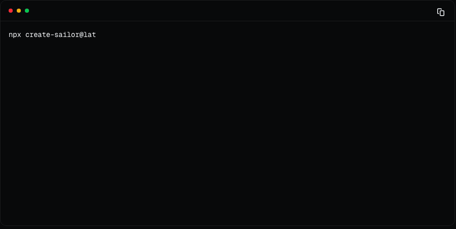
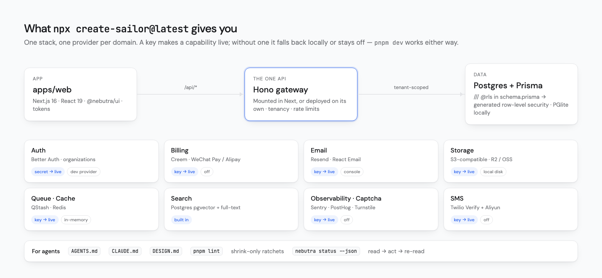

<div align="right">
  <a href="README.md">English</a> | <a href="README.zh-CN.md">简体中文</a> | <strong>日本語</strong>
</div>

<div align="center">
  <a href="https://nebutra.com/ja/sailor">
    <picture>
      <source media="(prefers-color-scheme: dark)" srcset="packages/design/brand/assets/logo/logo-inverse.svg" />
      <source media="(prefers-color-scheme: light)" srcset="packages/design/brand/assets/logo/logo-horizontal-en.svg" />
      
    </picture>
  </a>
  <h1>Sailor — Skip to production.</h1>
  <p>AI が書いたソフトウェアを本番に載せるための土台：認証、グローバルと中国の決済、マルチテナント、AI ゲートウェイをコマンド一つで。キー無しでローカル実行でき、コードはあなたのものです。Apache-2.0 のオープンソースです。</p>
  <p>
    <a href="https://github.com/Nebutra/Nebutra-Sailor/actions/workflows/scaffold-nightly.yml"></a>
    <a href="https://www.npmjs.com/package/create-sailor"></a>
    <a href="https://github.com/Nebutra/Nebutra-Sailor/stargazers"></a>
  </p>
  <p>
    <a href="https://nebutra.com/ja/sailor"><strong>Web サイト</strong></a> ·
    <a href="https://nebutra.com/docs"><strong>ドキュメント</strong></a> ·
    <a href="https://nebutra.com/ja/sailor/compare"><strong>比較</strong></a> ·
    <a href="https://github.com/Nebutra/Nebutra-Sailor/discussions"><strong>Discussions</strong></a> ·
    <a href="https://linux.do"><strong>LINUX DO</strong></a>
  </p>
</div>

<!-- VIDEO: 60 秒のデモ動画が下の録画を置き換えます。 -->
<p align="center"></p>

**自分で使う** — 生成して起動するだけ。キーも Postgres のインストールも不要です（ローカルは PGlite）:

```bash
npx create-sailor@latest my-app
cd my-app && pnpm dev        # アプリ :3001 · サイト :3000 · ゲートウェイ :3002
```

**エージェントに任せる**（Claude Code、Cursor、Codex など）— skill を入れてから指示します:

```bash
npx skills add Nebutra/Nebutra-Sailor --skill sailor
```

| 最初から入っているもの | 場所 |
| --- | --- |
| 決済: Creem（世界のカード決済、merchant of record）+ WeChat Pay / Alipay。サブスクリプション、クレジット、権限、従量課金 | `packages/commerce/billing` |
| マルチテナント: `schema.prisma` の `/// @rls` から Postgres ポリシーを生成（現在 91 件） | `packages/platform/db`、`packages/iam/tenant` |
| API はひとつ: Hono ゲートウェイを Next の `/api` にマウント（単一プロセス）、または単独デプロイ | `backends/gateway` |
| 認証: Better Auth（組織）と OIDC アイデンティティプロバイダー | `packages/iam/auth`、`apps/idp` |
| 1 ドメイン 1 プロバイダー: Resend、S3 互換ストレージ（R2 / OSS）、QStash、Redis、pgvector 検索、Sentry、PostHog、Turnstile。キーを入れれば本番、なければローカル実装 | `nebutra status --json` |
| エージェントが黙って壊せないガード: `AGENTS.md` / `CLAUDE.md` / `DESIGN.md`、Biome と縮小専用の lint ラチェット | `pnpm lint` |
| デザインシステム: `@nebutra/ui`、W3C DTCG トークン、Geist アイコン 541 個、ブランド言語 7 種、Storybook | `packages/design` |
| 中国スイッチ: `NEBUTRA_LOCALE=cn` で決済は WeChat Pay / Alipay 優先、SMS は Aliyun 優先、ICP フッターと AIGC 表示コンポーネントも同梱。OSS は同じ S3 アダプター経由 | `@nebutra/contracts/market` |
| CLI: エージェント向けの `nebutra status`、デバイスフローの `nebutra login` | `npx nebutra` |

**入っていないもの:** プロバイダーの選択肢（ドメインごとにアダプターはひとつ。必要ならインターフェースに沿って自作）、ホスティングの選択（Next の `standalone` ビルドと Dockerfile を提供）、電話番号ログイン（Better Auth の電話番号プラグインは未接続）、三方向マージによるテンプレート更新、モバイル / デスクトップアプリ、そして「小ささ」— これは 50 ファイルのスターターではなく完全な monorepo です。

**ライセンス:** Apache-2.0 — このリポジトリ、すべての npm パッケージ、生成したプロジェクトに適用されます。

<br />

## 技術スタック

<picture>
  <source media="(prefers-color-scheme: dark)" srcset="docs/assets/sailor-stack-dark.png" />
  
</picture>

各レイヤーに答えはひとつ — Nebutra が本番で動かしているものです（[ADR 2026-09-24](docs/architecture/2026-09-24-sailor-convergence.md)）。

| レイヤー | 採用技術 |
| --- | --- |
| アプリ | Next.js 16 · React 19 · TypeScript · Tailwind 4 |
| API | Hono ゲートウェイ（`backends/gateway`）· oRPC · Zod |
| データ | Postgres + Prisma 7 · 生成 RLS · pgvector · ClickHouse（計測）· ローカルは PGlite |
| 認証 | Better Auth（組織）· OIDC プロバイダー（`apps/idp`）· CASL 権限 |
| 決済 | Creem + WeChat Pay / Alipay |
| メッセージング | Resend · Twilio Verify + Aliyun SMS · QStash · Redis |
| ストレージ | S3 互換アダプターひとつ（Cloudflare R2、Aliyun OSS） |
| 可観測性 | Sentry · PostHog · OpenTelemetry |
| UI | `@nebutra/ui`（Radix）· W3C DTCG トークン · Geist アイコン · Storybook |
| AI | Vercel AI SDK · MCP · Python FastAPI はバッチ / ML 用途のみ |
| ツール | pnpm · Turborepo · Biome · Vitest · Playwright · changesets |

<br />

## プラットフォーム機能

Sailor は **1 ドメイン 1 プロバイダー** です（[ADR 2026-09-24](docs/architecture/2026-09-24-sailor-convergence.md)）。各パッケージは環境変数からキーを読み、キーがなければローカル実装に切り替わるため、空の `.env` でも `pnpm dev` が動きます。各パッケージはテスト用の in-memory 実装と、[tests/architecture/](tests/architecture/) のアーキテクチャテストで強制される厳格な TypeScript 契約を備えています。

<table>
<tr><th>機能</th><th>パッケージ</th><th>プロバイダー（自動検出）</th></tr>
<tr><td>認証</td><td><code>@nebutra/auth</code></td><td>Better Auth（組織、パスキー）</td></tr>
<tr><td>アイデンティティプロバイダー</td><td><code>@nebutra/oauth</code></td><td>OIDC (oidc-provider) · Redis セッション</td></tr>
<tr><td>権限</td><td><code>@nebutra/permissions</code></td><td>CASL — RBAC + ABAC、Hono ミドルウェア、React <code>&lt;Can /&gt;</code></td></tr>
<tr><td>マルチテナント</td><td><code>@nebutra/tenant</code></td><td>AsyncLocalStorage コンテキスト · Prisma RLS ブリッジ</td></tr>
<tr><td>キャプチャ</td><td><code>@nebutra/captcha</code></td><td>Cloudflare Turnstile</td></tr>
<tr><td>Vault（シークレット）</td><td><code>@nebutra/vault</code></td><td>AWS KMS エンベロープ · ローカル HKDF（開発用）</td></tr>
<tr><td>監査ログ</td><td><code>@nebutra/audit</code></td><td>追記専用ハッシュチェーン</td></tr>
<tr><td>キャッシュ</td><td><code>@nebutra/cache</code></td><td>Redis（Upstash REST プロトコル）· in-memory</td></tr>
<tr><td>レート制限</td><td><code>@nebutra/rate-limit</code></td><td>スライディングウィンドウ · トークンバケット (Upstash)</td></tr>
<tr><td>キュー</td><td><code>@nebutra/queue</code></td><td>QStash · in-memory</td></tr>
<tr><td>検索</td><td><code>@nebutra/search</code></td><td>Postgres — pgvector + 全文検索</td></tr>
<tr><td>ストレージ / アップロード</td><td><code>@nebutra/uploads</code></td><td>S3 互換アダプターひとつ（Cloudflare R2、Aliyun OSS）· ローカル FS</td></tr>
<tr><td>通知</td><td><code>@nebutra/notifications</code></td><td>組み込み配信 — アプリ内 · メール · プッシュ · SMS · チャット</td></tr>
<tr><td>Webhook</td><td><code>@nebutra/webhooks</code></td><td>組み込みの HMAC 署名配信（リトライ付き）</td></tr>
<tr><td>SMS</td><td><code>@nebutra/sms</code></td><td>Twilio Verify + Aliyun</td></tr>
<tr><td>メール</td><td><code>@nebutra/email</code></td><td>Resend + React Email テンプレート</td></tr>
<tr><td>請求</td><td><code>@nebutra/billing</code></td><td>Creem（カード決済、merchant of record）+ WeChat Pay/Alipay — サブスクリプション、利用量、エンタイトルメント</td></tr>
<tr><td>利用量計測</td><td><code>@nebutra/metering</code></td><td>ClickHouse リアルタイム集計</td></tr>
<tr><td>イベントバス</td><td><code>@nebutra/event-bus</code></td><td>マルチテナント Pub/Sub · ファンアウト · Request-Reply</td></tr>
<tr><td>Saga オーケストレーター</td><td><code>@nebutra/saga</code></td><td>自動ロールバック補償付きの TS ワークフロー</td></tr>
<tr><td>機能フラグ</td><td><code>@nebutra/feature-flags</code></td><td>DB ベース + 環境変数オーバーライド</td></tr>
<tr><td>デザイントークン</td><td><code>@nebutra/design-sync</code></td><td>W3C DTCG、git のみ</td></tr>
<tr><td>ステータス集約</td><td><code>@nebutra/status</code></td><td>OpenStatus · Atlassian StatusPage</td></tr>
</table>

<br />

## CLI と公式サイト

### npm から CLI を使う

新規プロジェクトでは、モノレポ全体を clone して削るのではなく、npm から開始できます。

```bash
# 新しい Sailor プロジェクトを作成
npx create-sailor@latest
npm create sailor@latest
pnpm create sailor@latest
bunx create-sailor@latest

# 既存の Sailor プロジェクトを運用
npx nebutra --help
npm install -g nebutra
```

| パッケージ | 用途 |
| ---------- | ---- |
| [`create-sailor`](https://www.npmjs.com/package/create-sailor) | 新しい Nebutra Sailor プロジェクトを作成します。質問はなく、毎回同じ収束済みスタックです（エージェントと CI には `--json`）。 |
| [`nebutra`](https://www.npmjs.com/package/nebutra) | 既存プロジェクトを運用します: `status`（何が本番で何にキーが要るか）、`sync`、`db`、`dev`、デバイスフローの `login`。 |

### nebutra.com

[`nebutra.com`](https://nebutra.com) は Nebutra Sailor の公開プロダクト入口であり、私たち自身がこのプラットフォームを dogfooding する場所です。今後のプロダクト更新、商用ライセンス、ホステッド機能、ローンチワークフロー、このモノレポで構築した実例は公式サイトで継続的に公開します。

<br />

## クイックスタート

### 必要環境

| ツール  | バージョン                                |
| ------- | ----------------------------------------- |
| Node.js | `v22+`                                    |
| pnpm    | `v11.28.5+`                                 |
| Python  | `3.11+` <sub>（マイクロサービス用）</sub> |

### この monorepo で開発する

プロダクトを作るなら、ページ上部の `npx create-sailor@latest` を使ってください。Sailor 自体に貢献する場合はクローンします:

```bash
# リポジトリをクローン
git clone https://github.com/Nebutra/Nebutra-Sailor.git
cd Nebutra-Sailor

# 依存関係をインストール
pnpm install

# 環境変数を設定
cp .env.example .env

# Prisma クライアント生成 & 開発サーバー起動
pnpm db:generate && pnpm dev
```

### コマンド一覧

| コマンド         | 説明                       |
| ---------------- | -------------------------- |
| `pnpm dev`       | 全アプリを開発モードで起動 |
| `pnpm build`     | 全パッケージをビルド       |
| `pnpm lint`      | リント実行                 |
| `pnpm typecheck` | 型チェック                 |
| `pnpm db:studio` | Prisma Studio を開く       |

<br />

## プロジェクト構成

```
Nebutra-Sailor/
├── apps/
│   ├── landing/      # マーケティングサイト
│   ├── web/               # メイン SaaS ダッシュボード
│   ├── studio/            # Sanity CMS
│   ├── api-gateway/       # BFF レイヤー
│   ├── docs/              # Mintlify ドキュメントサイト
│   ├── idp/               # アイデンティティプロバイダー
│   └── storybook/         # コンポーネント Playground
├── packages/
│   ├── create-sailor/     # CLI スキャフォールド (npx create-sailor)
│   ├── i18n/              # next-intl ルーティング & ロケール管理
│   ├── marketing/         # 高コンバージョン UI (Waitlist, Pricing, FAQ)
│   ├── email/             # トランザクションメール (Magic Link, Resend)
│   ├── agents/            # Vercel AI SDK ラッパー、エージェント、ストリーミング補助
│   ├── ai-providers/      # マルチプロバイダー AI レジストリとメタデータ
│   ├── brand/             # ブランドアセット、ガイドライン
│   ├── preset/            # 機能ベースのテンプレート設定
│   ├── theme/             # グローバルテーマトークン & CSS 変数
│   ├── ui/                # Radix + HeroUI + Nebutra UI プリミティブ
│   ├── icons/             # Geist アイコンライブラリ
│   ├── identity/          # 認証ヘルパー & テナント ID
│   ├── contracts/         # 共有 TypeScript 型 & Zod スキーマ
│   ├── legal/             # Cookie 同意、プライバシー、GDPR/CCPA
│   ├── db/                # Prisma 7 スキーマ & クライアント
│   ├── cache/             # Redis キャッシュ戦略
│   ├── rate-limit/        # マルチテナントレート制限
│   ├── mcp/               # AI エージェント用 Model Context Protocol
│   ├── logger/            # 構造化ロギング
│   └── ...                # その他多数
├── services/
│   └── ai/                # Python FastAPI - LLM、Embeddings
└── infra/                 # インフラ設定
```

<br />

## コントリビュート

コントリビューションを歓迎します！

|                    |                                                                  |
| ------------------ | ---------------------------------------------------------------- |
| **バグ報告**       | [Issue を作成](https://github.com/Nebutra/Nebutra-Sailor/issues) |
| **機能リクエスト** | Issue で提案                                                     |
| **プルリクエスト** | 機能追加やバグ修正の PR を送信                                   |

<br />

## バージョン管理とリリース運用

公開中のすべてのパッケージは公開 API が安定するまで **0.x の範囲**にあります。
[SemVer §4](https://semver.org/lang/ja/#spec-item-4) に従い、メジャーバージョンが
ゼロである契約は **0.x のいずれのリリースも破壊的変更を含む可能性がある**
ことを意味します — 本番環境では `"nebutra": "0.3.1"` のように厳密な
バージョンに固定し、caret 範囲は使わないでください。1.0 を切るまでは
このポリシーが続きます。

- バージョン管理は [changesets](https://github.com/changesets/changesets) によって駆動されます。公開対象パッケージに触れる PR は `.changeset/*.md` を含めて patch/minor/major を宣言する必要があります — CI でこのゲートを強制しています。
- 各パッケージの `CHANGELOG.md` は `changeset version` が生成し、バージョンアップと同じコミットでコミットされます（例: [`packages/ops/cli/CHANGELOG.md`](packages/ops/cli/CHANGELOG.md)）。
- リリースワークフローは **手動**（`workflow_dispatch`）です — PR マージで突然リリースされることはありません。関連する変更をまとめて一括でリリースを切ります。
- 1.0 前のメジャー API 変更（例: CLI コマンドの改名、パッケージ分類）は最初に **release candidate** を発行します: `nebutra@0.4.0-rc.0` を `next` dist-tag に乗せ、1 週間以上の soak テストを経てから `latest` に昇格させます。RC のインストール: `npm i nebutra@next`。
- npm 公開には **provenance attestation** が付与されます（npm レジストリ側で trusted-publishing が有効化された時点で。ワークフロー側はすでに準備済み — [`release.yml`](.github/workflows/release.yml) の `NPM_CONFIG_PROVENANCE: "true"` 参照）。公開済み tarball の検証: `npm view <pkg> --json | jq .dist.attestations`。

**API 安定**のシグナルとして `1.0.0` をリリースします。それまでは現行サーフェスを
「形は本番対応、細部は進化中」とお考えください。

<br />

## ライセンス

**Nebutra Sailor は [Apache License 2.0](./LICENSE) のオープンソースです。**
対象は本リポジトリ、すべての npm 公開パッケージ（`@nebutra/*`、`nebutra`、
`create-sailor`）、Sailor-Template ミラー、そして `create-sailor` が生成する
すべてのプロジェクト（Apache-2.0 の `LICENSE` と `NOTICE` を同梱）です。

商用製品の構築、クローズドソース化、ホスティングサービスとしての運用、fork —
すべて無料で、料金・ライセンスキー・登録・Copyleft は不要です。ソースを再配布
する場合は `LICENSE` と `NOTICE`、既存の著作権表示を保持し、変更したファイルを
明示してください（Apache-2.0 第4条）。

商標は別です：Apache-2.0 は商標権を付与しません（第6条）。自社製品に無関係な
名前を付ける分には許可は不要ですが、Nebutra や Sailor の名称使用には
商標ライセンスが必要です（[TRADEMARK.md](./TRADEMARK.md)）。

**有償プランが販売するのは使用許可ではありません。** コードライセンスでは
得られないもの — サポート確約、応答 SLA、補償、コンプライアンス文書
（DPA、セキュリティ資料、事業継続の確約）、商標権 — を販売します。
Community $0 · Team $2,000/年 · Enterprise $30,000/年〜 — 詳細は
[docs/legal/commercial-support.md](docs/legal/commercial-support.md)。

> 2026-10-16 に Apache-2.0 へ移行しました（以前は本リポジトリが FSL-1.1-ALv2、
> npm パッケージが MIT、2026-07-26 以前は AGPL-3.0-only）。それ以前にリリース
> されたバージョンは当時のライセンスのままです。詳細は
> [docs/legal/license-history.md](docs/legal/license-history.md)。

ライセンスに関するお問い合わせ: **legal@nebutra.com** ·
[ライセンス FAQ](docs/legal/licensing-faq.md)

<br />

---

<br />

<div align="center">
  <a href="https://nebutra.com">
    <picture>
      <source media="(prefers-color-scheme: dark)" srcset="packages/design/brand/assets/logo/logo-inverse.svg" width="100">
      <source media="(prefers-color-scheme: light)" srcset="packages/design/brand/assets/logo/logo-mono.svg" width="100">
      
    </picture>
  </a>
  <br />
  <br />
  <sub>
<strong>すべてのリリースで、成長が稼働する。</strong>
  </sub>
  <br />
  <br />
  <sub>© 2024-現在 <strong>無錫雲毓智能科技有限公司</strong></sub>
</div>
